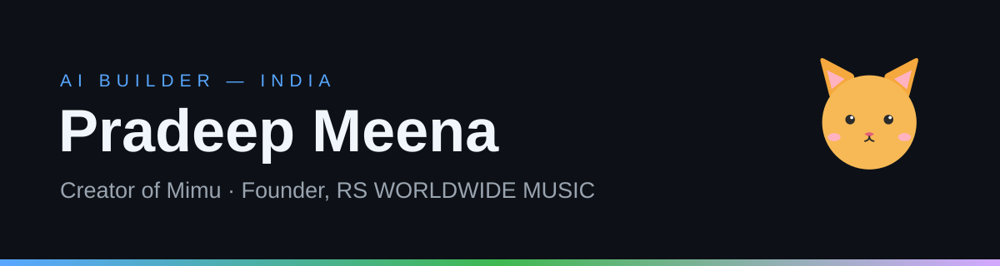

  

# Hi, I'm Pradeep Meena 👋

AI builder from India, working at the intersection of **AI, language and music**.

## 🚀 What I'm building

**[Mimu](https://github.com/motivationp81-star/mimu)** — my personal AI assistant, created in Google AI Studio. Mimu is a smart **Hinglish** creative AI: it chats naturally in Hinglish (Hindi + English), helps with creative ideas, and handles smart everyday tasks. Built with TypeScript.

More projects:

- **[Creator Toolkit](https://github.com/motivationp81-star/creator-toolkit)** — small TypeScript utilities for video creators: a YouTube title checker, a caption maker and a hashtag suggester.
- **[ClipKaro](https://github.com/motivationp81-star/clipkaro-video-trimmer)** — trim videos right in the browser and grab a frame as a thumbnail. [Live demo](https://motivationp81-star.github.io/clipkaro-video-trimmer/)
- **[Thumbnail Studio](https://github.com/motivationp81-star/thumbnail-studio)** — design video thumbnails on a canvas and export a 1280×720 PNG. [Live demo](https://motivationp81-star.github.io/thumbnail-studio/)
- **[PFP Maker](https://github.com/motivationp81-star/pfp-maker)** — make a cute profile picture in the browser: pick a character, colours and an accessory, download the PNG. [Live demo](https://motivationp81-star.github.io/pfp-maker/)

**Try my tools live:**

## 🎵 RS WORLDWIDE MUSIC

I run **RS WORLDWIDE MUSIC**, a record label and music distribution network — 9 YouTube channels and an Instagram label page, publishing regional (Rajasthani/Haryanvi) music. I use AI-assisted workflows end-to-end for publishing, distribution and audience engagement.

## 📊 GitHub stats

## 🧭 What I'm exploring

- AI agents and AI coding tools (including OpenAI Codex)
- Hinglish and regional-language AI experiences
- Practical AI workflows for creators and small labels

## 🐍 Watch the snake eat my contributions

## 📫 Reach me

Right here on GitHub — open an issue on the Mimu repo or connect with the label on Instagram at **@rsworldwidemusic**.

